# Task 1: Accessing the Lab \[10 minutes\] { #task-1-accessing-the-lab-10-minutes }

All components for this lab can be accessed through a web browser or VPN to dCloud

1. Click on the <strong>User Workstation 1</strong> icon on the topology page and it will bring up a fly-out window on left with <strong>Workstation 1</strong> related information. Under <strong>Remote Access</strong> you will see the workstations IP Address, Username, and Password as shown below.

    ![Task 1: Accessing the Lab [10 minutes] — screenshot 1](../assets/images/image7.jpg){ .lab-screenshot width="548" loading="lazy" }

2. You can click on any other Virtual Machine on the topology page to get its respective details.

## Step 1: Access the lab { #step-1-access-the-lab }

### Option A: Accessing the Lab with Web RDP/ Remote Desktop \[Preferred\] { #option-a-accessing-the-lab-with-web-rdp-remote-desktop-preferred }

1. With this method, you will use <strong>Workstation 1</strong> as your main access to all the other lab virtual machines or Cisco UC applications needed to complete the lab tasks: Cisco UCM, Unity Connection, Collaboration Control Hub Admin Portal, etc.


2. To access <strong>Workstation 1</strong> over <strong>Web RDP</strong>, click on the <strong>Workstation 1</strong> icon on the topology page and in the fly-out window with workstation 1’s details, expand the ‘<em>Remote Access</em>’ <em>section</em> and click on <em>‘Web RDP</em>’. It will open a new browser tab and connect you to Workstation 1.

    ![Option A: Accessing the Lab with Web RDP/ Remote Desktop [Preferred] — screenshot 2](../assets/images/image8.jpg){ .lab-screenshot width="541" loading="lazy" }

### Option B: Accessing the Lab with VPN { #option-b-accessing-the-lab-with-vpn }

1. To connect to <strong>Workstation 1</strong> using your local RDP connection, first, you need to connect to your lab session via VPN. Open the <strong>Cisco AnyConnect</strong> client on your laptop. It will prompt you for the Host Address, username, and password information for your session.


2. You will find all these details on the <strong>Info</strong> page of your lab’s topology page. In the fly-out window expand the ‘<em>Cisco Secure Client Credentials</em>’ section where you will see the <strong>VPN details</strong> of your lab. Enter all the details as shown below and click “<em>OK</em>” to connect to your session.<br><br><mark>The Host Address, username, and password will be different for each lab. Use <strong>YOUR OWN</strong> assigned lab details.</mark>

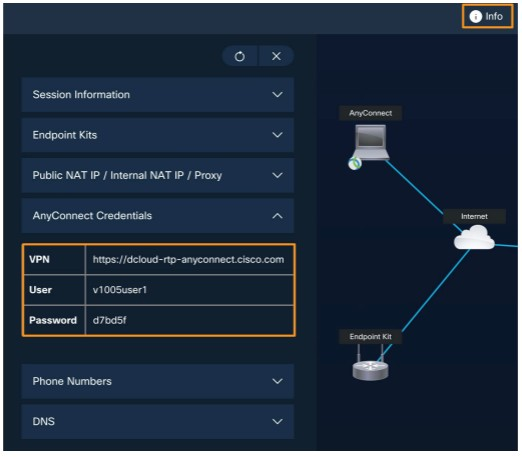{ .lab-screenshot width="522" loading="lazy" }

3. Once you are connected to your lab session over VPN, you can open a local RDP connection on your laptop and connect to <strong>Workstation 1</strong> using the following details:

    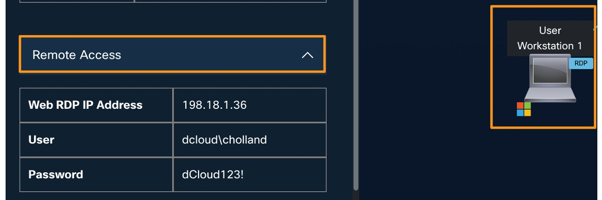{ .lab-screenshot width="572" loading="lazy" }

## Step 2: Continuing the lab on User Workstation 1 Desktop { #step-2-continuing-the-lab-on-user-workstation-1-desktop }

Going forward it does not matter which option you used to connect to your lab’s Workstations

1. Back on your dCloud lab topology page, click on the <strong>Info</strong> tab and a fly-out window will open on the left side. Here you will find all your lab-related information like the <strong>Session ID</strong>, VPN connection details, <strong>DNS Domain name</strong> and <strong>PSTN Numbers</strong>, etc. You will need all this information throughout this lab.

    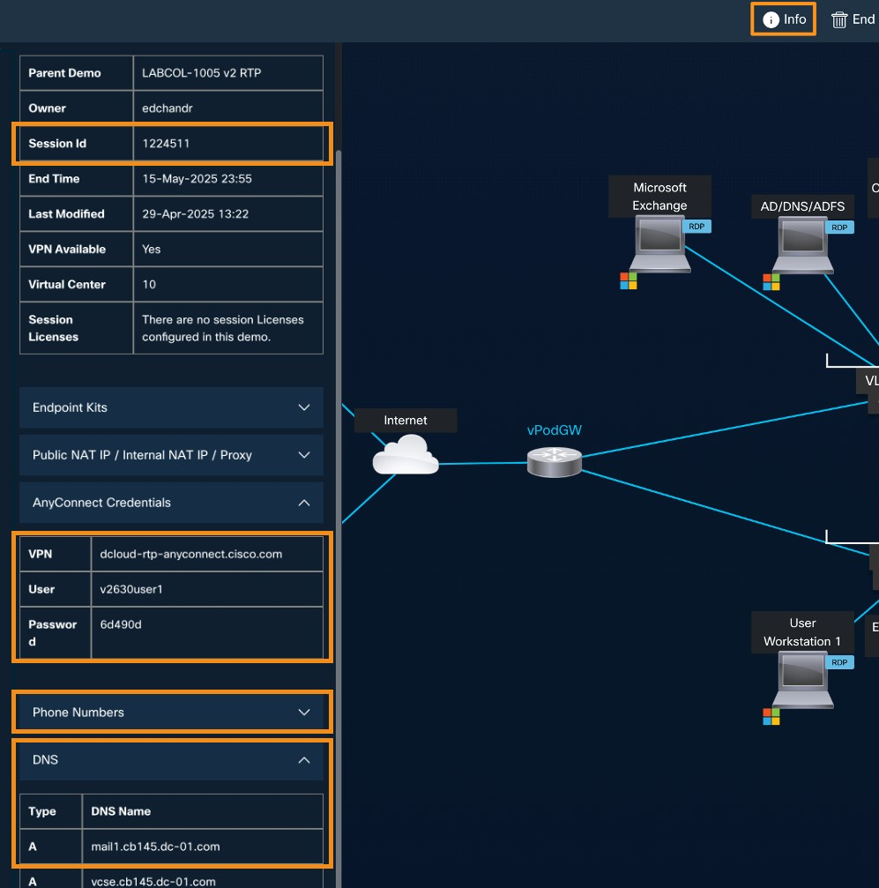{ .lab-screenshot width="549" loading="lazy" }

- <strong>Session ID:</strong> found under the <em>Session Information</em> section, example shown above (e.g. 122<mark><u>4511</u></mark>). YOURS WILL BE DIFFERENT. This info is also found in the <strong>Lab\_Info.txt</strong> file on <strong>Workstation 1’s</strong> desktop.


- <strong>Webex password:</strong> dCloud<mark>ZZZZ</mark>! (dCloud + <em>last four digits of session ID</em> + !), example shown above (dCloud<mark>4511</mark>!). YOURS WILL BE DIFFERENT.


- <strong>Domain Name:</strong> found under the <em>DNS</em> section. It will be in the <strong>cbXXX.dc-YY.com</strong> format.

!!! tip

    All this info can also be found in the “<strong>Lab\_Info.txt</strong>” or “<strong>Session\_Info.txt</strong>” files on Workstation 1’s desktop

## Step 3: Login Credential for Control Hub and Webex App { #step-3-login-credential-for-control-hub-and-webex-app }

1. On <strong>User Workstation 1</strong> desktop, there is a notepad file “<strong>WEBEX\_PASSWORD.txt</strong>” that has the UserID and password credential for Charles Holland (Admin for Collaboration Control Hub). These are used to login to Control Hub and into the Webex App. Make note of this file and its content.<br><br>See example below. <strong>Your lab’s User ID domain and password will be different.</strong>

    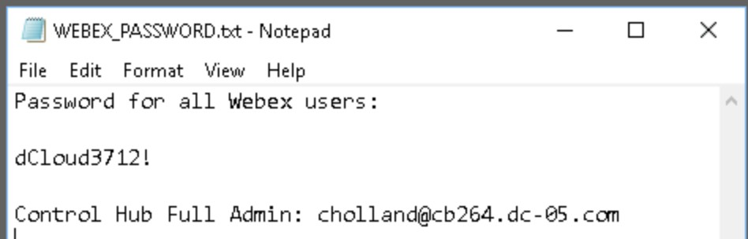{ .lab-screenshot width="864" loading="lazy" }

!!! tip

    To locate this file, left click (single click) on any file displayed on the Workstation 1’s desktop, then press "W" repeatedly until the desired file is highlighted.

    If you're unable to find the file, follow the steps below to retrieve the user ID and password using an alternative method.

- Control Hub and Webex App UserID format:

userid@<em><mark>domain\_name</mark></em>

- Webex password for all users, including Control Hub access:

dCloud<em>ZZZZ</em>! <em>(where <mark>ZZZZ</mark> = last four digits of Session ID)</em>

The example above has the domain <strong>cb264.dc-05.com</strong> and the Session ID’s last four digits are <strong>3712</strong>. Below are the Webex UserIDs and password for this example (<strong>Your lab’s UserID’s domain and Session ID will be different</strong>):

<u>Webex UserIDs</u>:

[cholland@<mark>cb264.dc-05.com</mark>](mailto:cholland@cb264.dc-05.com)

[aperez@<mark>cb264.dc-05.com</mark>](mailto:aperez@cb264.dc-05.com)

[kmelby@<mark>cb264.dc-05.com</mark>](mailto:kmelby@cb264.dc-05.com)

[tbard@<mark>cb264.dc-05.com</mark>](mailto:tbard@cb264.dc-05.com)

For this example, the Control Hub password for Charles Holland and Webex App password for <strong>ALL</strong> users is:

dCloud<em>3712!</em>

## Step 4: Update Local Gateway (LGW) Config { #step-4-update-local-gateway-lgw-config }

For this lab you will use 2 PSTN numbers to call in to the Auto Attendant and AI Receptionist. The lab has 1 of these numbers pre-configured so you need to configure the LGW to route the second PSTN number to Webex Calling from the CUBE PSTN gateway.

1. On <strong>Workstation 1’s</strong> desktop, find and open the file “<strong>Lab\_Info.txt</strong>”. This file contains the PSTN numbers assigned to your lab.


2. Find the PSTN number assigned to the <strong>External Caller</strong> and extension <strong>86023</strong>. The PSTN number will be at the end of the line. In the example below, the PSTN number is +441189162233 (<strong>Your lab’s PSTN number will be different</strong>):

    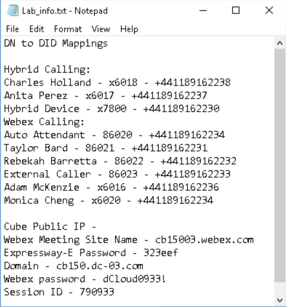{ .lab-screenshot width="590" loading="lazy" }

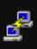{ .lab-icon width="29" loading="lazy" }

3. On <strong>Workstation 1’s</strong> desktop open Putty from the taskbar


4. In the Putty Configuration window double click on ‘<em>Local Gateway</em>’ under the saved sessions to open an SSH session to the device.

    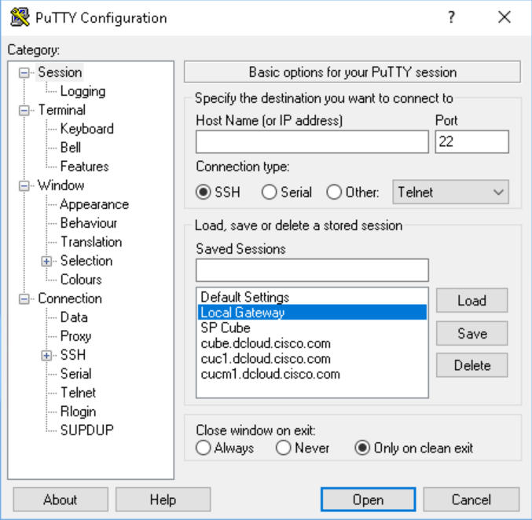{ .lab-screenshot width="356" loading="lazy" }

5. Log into the LGW using the credentials:

    - Login as: <em>admin</em>


    - Password: <em>dCloud123!</em>

        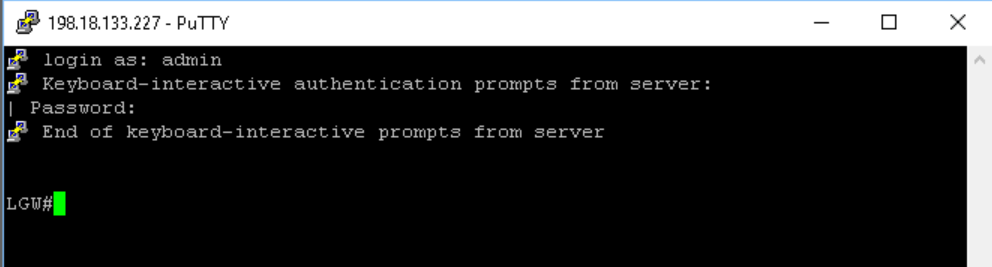{ .lab-screenshot width="560" loading="lazy" }

6. If you type `show run | s voice translation-rule 100000` you will see there is already 1 translation rule for extension 7000.

    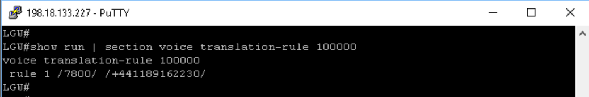{ .lab-screenshot width="561" loading="lazy" }

7. Next you will add a new translation rule for the External Caller extension and phone number you found in step 2 above. Enter the following CLI commands to configure the second translation rule:

    Replace the example phone number below with your lab's External Caller PSTN number from step 2.

    ```text
    config t
    voice translation-rule 100000
    rule 2 /6023/ /+441189162233/
    end
    wr mem
    ```

    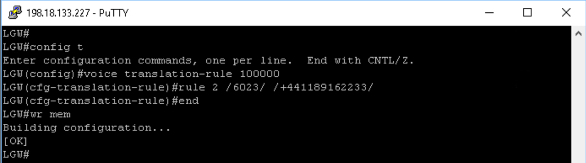{ .lab-screenshot width="557" loading="lazy" }

8. To confirm the translation rule has been updated, type `show run | s voice translation-rule 100000` and you should see both the existing rule and the new rule.

    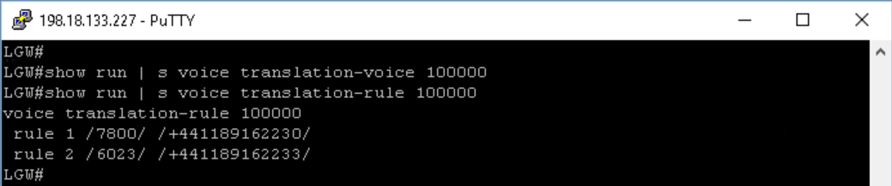{ .lab-screenshot width="566" loading="lazy" }

9. Type ‘<em>exit’</em> and close the Putty app.

<strong>This task is now completed. Proceed to the next task.</strong>
